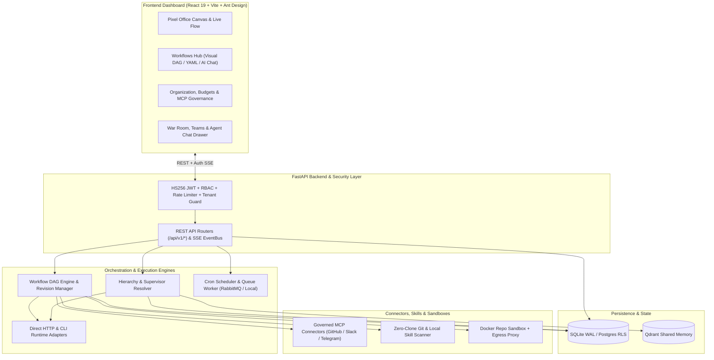
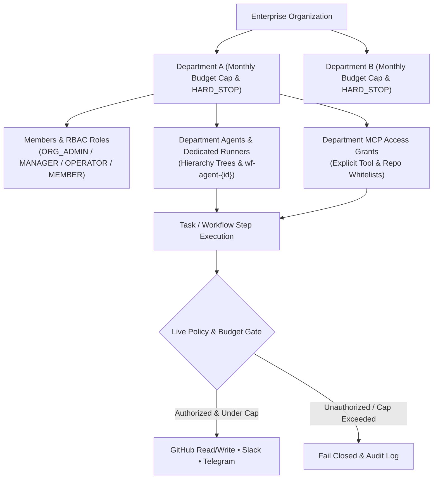
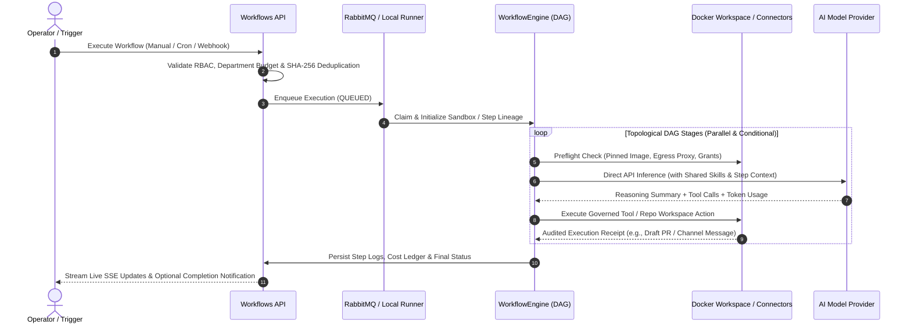
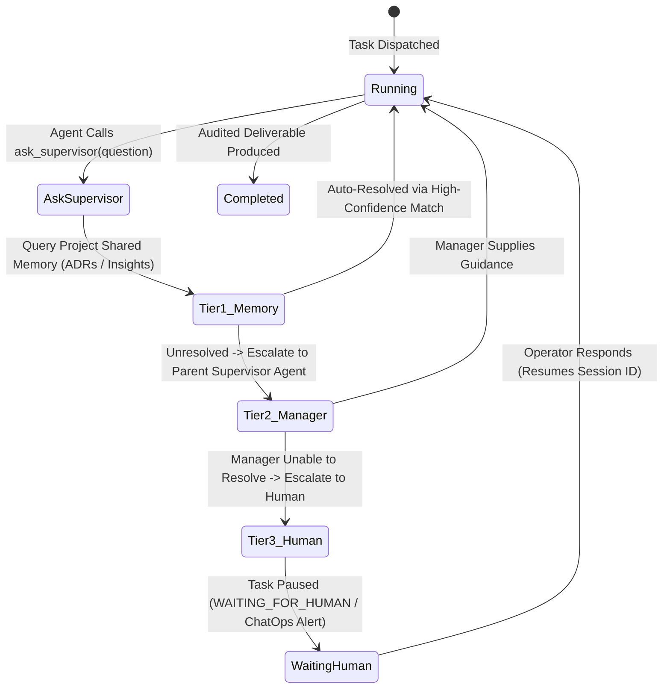

# AI Agents Platform

An enterprise-grade, multi-tenant autonomous AI agent orchestration, workflow automation, and governance platform. It combines hierarchical agent teams, visual & YAML DAG workflow execution, governed Model Context Protocol (MCP) connectors, sandboxed repository workspaces, real-time war room deliberations, and an interactive pixel office canvas under strict per-department budget and tool-access controls.

---

## ✨ Key Capabilities

| Pillar | Highlights |
| :--- | :--- |
| **🏢 Multi-Tenant Governance** | Organization & Department isolation, 4-tier RBAC (`ORG_ADMIN`, `MANAGER`, `OPERATOR`, `MEMBER`), monthly department USD budgets, configurable alert thresholds, and `HARD_STOP` spending enforcement. |
| **🔄 Visual & AI Workflows** | Declarative YAML/JSON playbooks, visual DAG builder, AI-assisted workflow authoring ("Create with AI"), revision history with optimistic concurrency, tool-free Playground runs, and RabbitMQ or local background execution. |
| **🔌 Governed MCP & Connectors** | Built-in connector catalog (GitHub, GitLab, Telegram, Slack, Trello, PostgreSQL, Brave Search, Filesystem), live zero-clone repository discovery, department tool whitelisting, and audited channel delivery receipts. |
| **📦 Sandboxed Repo Workspaces** | Ephemeral host-cloned Git workspaces mounted into network-isolated Docker containers (`PLATFORM_SANDBOX_IMAGE`) with optional HTTPS egress proxy allowlists, AES-GCM encrypted secrets, and receipt-verified draft PR creation. |
| **🤖 Autonomous Agent Hierarchy** | Reporting chains (`parent_id`, `allowed_child_ids`), multi-tier supervisor escalation (`Shared Memory ➔ Manager Agent ➔ Human Operator`), Agent-to-Agent (A2A) messaging, dynamic squads, and War Room councils. |
| **⚡ Direct Multi-Provider Runtime** | Provider-agnostic execution across Anthropic Claude, OpenAI (Responses & Chat), NVIDIA NIM, OpenRouter, and CLI runtimes with per-call token pricing, session cost ledgers, and provider-visible reasoning summaries. |
| **🎮 Interactive Pixel Office & UI** | React 19 + Ant Design `Robotic` UI toolkit, live 2D pixel office canvas streaming real-time SSE agent states, full English (`en`) and Hebrew (`he` RTL) localization. |

---

## 🏛️ System Architecture



---

## 🔐 Multi-Tenant Hierarchy & Tool Governance

Organizations partition users, agents, budgets, and MCP connectors by department. Every tool call or repository action is verified against live database grants before execution.



---

## 🔄 Workflow Execution Lifecycle

Workflows support interactive AI authoring, visual step editing, tool-free Playground testing, and governed production execution with receipt-verified outcomes.



---

## 🧠 Multi-Tier Agent Clarification Flow

When an autonomous agent encounters missing requirements or ambiguity, it never guesses or falsely marks work as complete—it escalates through a structured 3-tier resolution protocol:



---

## 📂 Repository Structure

```text
ai-agents-platform/
├── poc/
│   ├── backend/                # FastAPI application, lifespan, middleware & domain modules
│   │   ├── api/                # REST routers (workflows, organizations, mcp, agents, tasks, etc.)
│   │   ├── approvals/          # Human-in-the-loop (HITL) approvals & Slack/Telegram callbacks
│   │   ├── chat/               # Interactive agent mini-chat & blocker resolution
│   │   ├── db/                 # Enterprise PostgreSQL RLS schema definitions
│   │   ├── events/             # In-memory pub/sub EventBus & persistent SSE streaming
│   │   ├── memory/             # Project shared memory (ADRs, conventions, Qdrant indexing)
│   │   ├── messages/           # Agent-to-Agent (A2A) structured messaging
│   │   ├── queue/              # RabbitMQ priority queues & dead-letter exchanges
│   │   ├── scheduler/          # Background cron polling & croniter forecasting
│   │   ├── security/           # HS256 JWT, PBKDF2 hashing, rate limiting, tenant guards
│   │   ├── teams/              # Multi-agent squads & deliverable synthesis
│   │   └── war_room/           # Multi-agent debate rounds & consensus synthesis
│   ├── workflows/              # DAG parser, execution engine, sandboxes & preflight checks
│   ├── runtime/                # Direct HTTP providers (Anthropic, OpenAI, NVIDIA, OpenRouter), pricing & CLI adapters
│   ├── orchestration/          # Hierarchy validation, supervisor chain & delegation service
│   ├── integrations/           # Governed GitHub, Telegram & Slack execution adapters
│   ├── plugins/                # Local filesystem & zero-clone GitHub API skill scanners
│   ├── storage/                # Composed SQLite repositories, records & connection management
│   ├── dashboard/              # React 19 + TypeScript + Vite + Ant Design frontend
│   │   └── src/
│   │       ├── canvas/         # 2D virtual pixel office engine & sprite animation
│   │       ├── components/     # Reusable `Robotic` UI component library & step editors
│   │       ├── context/        # Auth, Office SSE, and Notification state providers
│   │       ├── hooks/          # Custom hooks (permissions, SSE events, caching)
│   │       ├── i18n/           # Full English (en.ts) & Hebrew (he.ts) translations
│   │       ├── pages/          # Route views (Office, Workflows, Organization, MCP, War Room)
│   │       └── services/       # Typed HTTP client & domain API wrappers
│   ├── tests/                  # Real-SQLite, zero-mock integration & contract test suites
│   └── start_api.py            # Environment-aware Uvicorn launcher
├── docs/                       # Detailed architecture, security, runtime & workflow guides
├── AGENTS.md                   # Root architectural invariants & documentation index
├── CLAUDE.md                   # Developer guide & verification workflows
└── pyproject.toml              # Python dependencies & project metadata
```

---

## 🚀 Getting Started

### Prerequisites
* **Python**: `>= 3.11` (managed via `uv` or standard `venv`)
* **Node.js**: `>= 20.x` & `npm`
* **Optional Services**:
  * **Docker**: Required only for isolated repository workspace steps (`PLATFORM_SANDBOX_IMAGE`).
  * **RabbitMQ**: Optional distributed broker (`AMQP_URL`); falls back cleanly to local background execution.

### 1. Backend Setup

```bash
# Create virtual environment and install dependencies
uv venv
source .venv/bin/activate
uv pip install -e ".[dev]"
```

Create a `.env` file in the repository root with a strong JWT secret (at least 32 characters):

```env
# Required security secret (>= 32 characters)
JWT_SECRET_KEY=replace-with-a-random-32-byte-minimum-secret-key

# Optional: Encryption key for workflow secrets (32-byte base64 or hex)
# PLATFORM_SECRETS_KEY=...

# Optional: AI Provider API Keys
# ANTHROPIC_API_KEY=sk-ant-...
# OPENAI_API_KEY=sk-...
# NVIDIA_API_KEY=nvapi-...
```

Launch the FastAPI server (automatically loads `.env` from the repository root):

```bash
uv run python poc/start_api.py
```
The API will be available at `http://localhost:8000` (health check at `GET /health` and readiness at `GET /health/ready`).

### 2. Frontend Setup

```bash
cd poc/dashboard
npm install
npm run dev
```
Open `http://localhost:5173` in your browser to access the platform dashboard.

---

## 🛡️ Security & Operational Principles

* **Fail-Closed Startup & Execution**: Requires a valid `JWT_SECRET_KEY` (`>= 32` characters) outside explicit dev mode (`PLATFORM_DEV_MODE=1`). Workflow steps fail closed if required connector grants, budget allowances, or sandbox prerequisites are missing.
* **Receipt-Backed Outcomes**: Channel notifications and draft Pull Requests require verified backend execution receipts—never trusting unverified model text claims.
* **Write-Only Encrypted Secrets**: Workflow secrets are encrypted at rest via AES-GCM (`PLATFORM_SECRETS_KEY`) or referenced via allowlisted AWS Secrets Manager ARNs, injected exclusively into container sandboxes, and automatically redacted from logs.
* **Zero-Mock Testing Philosophy**: Contract and integration tests run against real SQLite databases and real FastAPI routers rather than mocked persistence layers.

---

## 📚 Documentation Map

Detailed technical contracts and module guides are maintained across the repository:

* **Architecture & Root Guides**: [`AGENTS.md`](AGENTS.md) • [`CLAUDE.md`](CLAUDE.md)
* **Feature & Operations Guides**:
  * [Runtime Provider Setup](docs/runtime-provider-setup.md)
  * [Security Configuration](docs/security-configuration.md)
  * [Governed Connector Execution](docs/connector-execution.md)
  * [Capability Policy Configuration & Rollout (P01)](docs/governance-policy-guide.md)
  * [Policy Algebra, Roles & Agent Authority](docs/architecture/p01-policy-algebra.md)
  * [Governance API & Schema](docs/architecture/p01-governance-api.md)
  * [Sandboxed Repository Workspaces](docs/repo-workspaces.md)
  * [Workflow Settings & Secrets](docs/workflow-settings.md)
  * [AI Workflow Creation Chat](docs/workflow-chat.md)
* **Module Contracts**:
  * [Backend Core](poc/backend/AGENTS.md) & [REST API Routers](poc/backend/api/AGENTS.md)
  * [Workflows Engine](poc/workflows/AGENTS.md) & [Runtime Abstraction](poc/runtime/AGENTS.md)
  * [Orchestration & Hierarchy](poc/orchestration/AGENTS.md) & [SQLite Storage](poc/storage/AGENTS.md)
  * [Frontend Dashboard](poc/dashboard/AGENTS.md) & [UI Component Library](poc/dashboard/src/components/AGENTS.md)
