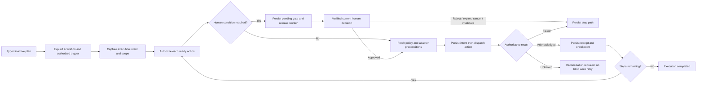

# AI-15 ADR: provider-neutral workflow governance

Date: 2026-11-06. Status: **P00 planning decision record; implementation gated by P01–P11**.
It does not assert user approval of every detail, deployment or implemented future behavior.
[AI-15](https://trello.com/c/piRgSBUJ) · [Epic AI-12](https://trello.com/c/HqVN3GDu).
Inputs: [AI-13 source/contract](connector-governance-contract.md),
[API evidence](ai-13-api-audit.md), [AI-14 UX](../design/governance-ux.md).

## Context and scope

Organization members need to describe workflows using capabilities an administrator made
available to their department. Providers differ, but tenant authority, planning, event
routing, waiting for approval, execution receipts and recovery should be shared.

The existing branch stack supplies useful foundations: current DB identities and resource
checks (#26), bounded GitHub/Telegram/Slack operations and one persisted terminal approval
slice (#27), and isolated HTTP baseline coverage (#28/AI-13). Those are not equivalent to
a provider-neutral adapter contract, verified channel ingress or arbitrary approval/resume.
Open/unmerged branches must not be described as master or production capabilities.

P00 produces reviewable contracts, UX and documentation; it adds no production routes,
schema migrations, credential changes, grants, activations or external provider calls.
The runnable HTTP baseline remains the current behavior evidence, not proof of the target.

## Decisions and rejected shortcuts

### D01 — shared engine, implementation-owned adapters

Keep action scheduling, policy, approval, audit and recovery in the control plane. A trusted
adapter supplies typed descriptors, resource canonicalization, provider event verification,
execution and reconciliation where supported. Discovery/install metadata cannot register
code or confer authority. Each advertised executable capability has an implementation/version
and conformance tests; unsupported connectors/actions remain explicitly unavailable.

Rejected: a Dependabot-specific workflow engine; a fresh engine per provider; arbitrary
HTTP/URL/shell RPC as a universal connector. GitHub is a reference adapter, not a core
resource type. CRM/Tracker wireframes are illustrations, not shipped integrations.

### D02 — central effective policy, checked repeatedly

An effective action decision intersects organization/department, principal/agent, workflow,
step and exact resource constraints with its captured upper bound. Proposed explicit deny
wins. Required human approval is an additional condition on an otherwise authorized action;
it cannot create a missing grant. Current user/role/membership, resource grants, validity,
budget and implementation version are checked before catalog projection/save/start/resume
and again before the external action. Remote writes cannot be made atomic with local
permission changes; document the actual revocation/transaction boundary.

The organization admin controls own-org policy and credentials. Default department managers
manage authorized workflows and approve according to policy, but do not implicitly acquire
connector-administration rights. Member/Operator authoring is allowed in their authorized
department; saving is not permission to activate or execute a plan. Do not infer an execution
service principal or its broader rights from the author's natural-language request.

Rejected: stale JWT role as authorization; unioning scopes; approval as privilege escalation;
admin cross-tenant bypass; a missing department using a legacy unrestricted fallback.

### D03 — separate readiness facts and truthful planning

Supported implementation, configured credentials, authorized resources and provider-verified
connectivity/time are independent facts. Installed/CONNECTED metadata and the current
configuration-only execution_supported flag must not be rendered as a successful provider
handshake. Missing/expired/unknown facts remain visible. AI/manual/YAML share typed plan
semantics and current capability/resource choices. An unavailable action returns a precise
clarification; replacing approval with notification needs the user's explicit request change.

Rejected: advertising catalog names as implemented tools, treating a green metadata badge as
connectivity evidence, inventing receipts, or silently producing a weaker runnable workflow.

### D04 — bindings separate send, trigger and approval

A binding identifies a connector plus exact provider channel under an organization and
department, with independent send/trigger/approval uses. Sender policy and approval policy
are distinct. Three trigger modes may be explicitly supported: linked authorized users,
explicit allowed subjects, or group requests under a restricted service principal with a
fixed workflow/resource ceiling. Group membership alone grants no organization identity,
no new action scope and no human approval rights.

Rejected: adding a destination enabling a listener; inheriting approval authority from
channel membership; model text picking another workflow/resource/principal at trigger time.

### D05 — connector ingress, proved identities and durable event receipts

Use a provider-verified endpoint per connector with internal routing by immutable binding,
workflow execution and approval/action IDs. Respect provider-specific deployment constraints
(e.g. one Telegram webhook per bot). A reachable HTTPS endpoint is a transport prerequisite,
not a business grant. Provider authenticity and linked platform identity are independent.
External identities are proved via bounded one-use challenges scoped to connector/provider
account/workspace and platform user; provider display names never identify an approver.

Verify authenticity before parsing privileged action data, normalize bounded envelopes,
record dedup receipts and dispatch through an outbox. Restrict replay windows/rate/budget/
concurrency, bot loops, message edits and ambiguous anonymous/bot identities. Unsupported
verification means no privileged ingress. Never reenable legacy shared-global-secret
callbacks merely because a new URL exists.

Rejected: authority-bearing per-agent webhook URLs, a forwarded message as identity proof,
calling the model before event authorization, or executing an unpersisted plan from chat text.

### D06 — approvals bind an exact action, not an agent or generic yes

Approval identity includes execution/step, action-intent/input/evidence digests, workflow/
policy versions, scope, approver selectors, expiry and quorum/separation-of-duties if defined.
An actual currently authorized personal user supplies the decision. Channel-native actions
add provider verification, exact binding/message match and one-use expiring action tokens;
platform identity/policy must still be checked. A dashboard link remains a safe fallback,
with no bearer authority in the URL. Quorum votes deduplicate the same human across channels.

The generic approval engine makes the decision; adapter freshness preconditions guard the
pending action. SHA checking is a GitHub adapter detail, while evidence-version checking
is generic. Modified evidence/workflow or revoked authority blocks or invalidates the old
approval. The AI cannot approve its own pending request or weaken central approval policy.

Rejected: approving an agent for all future work, trusting a callback payload user_id,
unbounded generic approve tokens, or calling a notification an approval checkpoint.

### D07 — checkpointed continuation, no waiting worker or side-effect replay

Generalize the existing terminal gate through persisted execution checkpoints, pinned
workflow definition/revision, dependency cursor, completed outputs and receipts. Waiting
releases workers. A claimed decision schedules continuation; it must not relaunch the whole
DAG or replay completed external writes. Cancellation/expiry/rejection and changed evidence
have explicit transitions. Quorum, leases and restart recovery require real concurrent API/
storage tests before release. The existing RESOLVING state is not silently retried.

Separate plan/configuration, execution, approval and external-action lifecycles:

This is the target state flow, not current executable middle-DAG behavior. Approved means
“decision recorded,” not “external action succeeded.” Branch/field/resource constraints,
current scope and evidence must survive the wait without silent expansion.

### D08 — receipts, unknown outcomes and recovery are first-class

Persist intent before external writes, use deterministic per-action claims and provider
idempotency only where genuinely supported. Record provider acknowledgement before success.
Partial batches retain per-item outcomes; cancellation cannot recall a dispatched external
request. Unknown results require supported reconciliation or an explicitly authorized
manual recovery, never an unconditional Retry button. Do not promise exactly-once writes.

GitHub's expected-head SHA is a provider precondition; there is no REST atomic expected-base
precondition. Existing batch merges may advance base and invalidate remaining subjects.
Other adapters document their own precondition/race/idempotency limitations. The shared
engine must not assume every provider offers the same guarantees.

### D09 — shared scope-aware UX and agent instruction contract

Implement AI-14's role journeys and readiness/error vocabulary using existing dashboard
components. Clear old data and ignore late responses when identity/department changes.
Do not load admin APIs just to render a member's read-only view. An existing header department
with failed/empty authoring context is a context-load mismatch, not evidence to tell an admin
to join the department. Only current server facts should decide what the user can select/do.

Agent instructions must require model-only proposals from the current catalog, strict resource
IDs, truthful missing-capability clarification, untrusted external content as data, and no
invented approvals/receipts. Execution instructions describe authorized future work. Changing
docs alone does not teach the runtime new actions: actual prompt/schema updates ship with
the corresponding implemented capability (P09), not prematurely in this planning task.

### D10 — migrate without expanding authority

Reuse Actor/Resources/router guards, frozen scopes/audit claims, existing PR readers and the
terminal approval rows as migration inputs; don't replace the entire platform at once.
Add versioned descriptors/policy/bindings/checkpoints alongside legacy data, validate and
migrate explicitly, preserve history and receipt identities. Unknown grants stay inert;
read wildcards do not become write rights. No orphan claiming, automatic credential copy,
new identity mapping, webhook installation, workflow activation or grant expansion occurs
as a side effect. Each schema/API change is reviewed in its owning implementation ticket.

## Baseline vs target / ownership

| Layer | Reusable current foundation | Missing or partial target | Owner |
|---|---|---|---|
| Policy | Current DB Actor, inherited resource checks, capped roles | Typed/versioned action/resource decisions | P01 |
| Adapters | Governed GitHub/Telegram/Slack slices | Descriptor/execution/conformance boundary; additional separate actions | P02 |
| Channels | Exact outbound allowlists | Department bindings and independent uses/readiness | P03 |
| Identity | Platform session/account | Proved provider-account identities, link/revoke | P04 |
| Ingress | Denied legacy callbacks | Verified events, ledger/outbox/rotation | P05 |
| Triggers | Saved declaration metadata | Authorized rules, fixed principals/input mapping | P06 |
| Approvals | One terminal persisted dashboard gate | Durable middle-DAG continuation/quorum/recovery | P07 |
| Channel decisions | Authenticated dashboard link delivery | Verified interactive approval callbacks | P08 |
| Planning | Current bounded catalog/proposals/inactive save | Shared provider-neutral action/event/approval IR | P09 |
| Operations | Existing call/merge receipts | Unified provenance, delivery/reconciliation | P10 |
| Release | Existing tests + 39 API-only contracts | Concurrent/replay/restart/provider conformance and rollout | P11 |

P00 review artifacts do not mark those implementation rows complete. Source-backed details
and exact existing routes are in AI-13, rather than duplicated as speculative new endpoints.
The FE should integrate proposed contracts only after their BE ticket publishes actual routes,
schemas/state enums, error codes and pagination/readiness behavior.

## Release gates and agent/developer obligations

1. P00: source evidence, proposed contract, role journeys, static wireframes and API baseline;
   current/proposed/deployed must be labelled distinctly. No runtime capability claims.
2. P01/P02: strict descriptor/policy/action contracts and cross-tenant/role/write-negative
   HTTP tests. New adapter metadata cannot register execution or grant itself permissions.
3. P03–P06: binding/identity/verified ingress/dedup/principal tests before channel triggers;
   sender-group opt-in cannot authorize approvals or broaden resources.
4. P07/P08: atomic decision/concurrency/TTL/invalidation/checkpoint/restart tests before
   channel approvals or general resume. Channel-native buttons stay unavailable until verified.
5. P09/P10: schema/plan consistency, no silent downgrade, per-action receipts/unknown recovery,
   scoped audit and no secrets in output. Public labels never imply provider verification.
6. P11: migrations preserve denials/history, feature flags/rollback documented, staged provider
   conformance only with explicit authorization. No provider/model I/O in ordinary API suites.

Every source change updates its directory's AGENTS.md and CLAUDE.md where applicable in the
same commit. Register new module guides in the root index. Owned source stays <=500 physical
lines. Tests use real FastAPI/SQLite, not synthetic provider-success adapters. The user has
explicitly authorized local API-only testing; agent/model/provider execution, application
startup and unrelated local runtime/browser validation remain outside that authorization.

## Consequences and verification boundary

This design requires explicit adapter work for each provider; it does not make every action
available on every connector. It makes policy/events/approvals/recovery reusable and keeps
provider-specific side effects behind a narrow typed contract. Additional schema/state work
is required, and it must preserve historical execution/approval records without implicit replay.

P00 uses static visual inspection and document consistency plus the existing 39 HTTP baseline.
No UI component/browser flow, live provider verification, real event/approval callback,
provider write, agent/model generation, middle-DAG resume or production migration was executed.
PRs and local test artifacts are review evidence, not deployment approval or a zero-risk claim.
