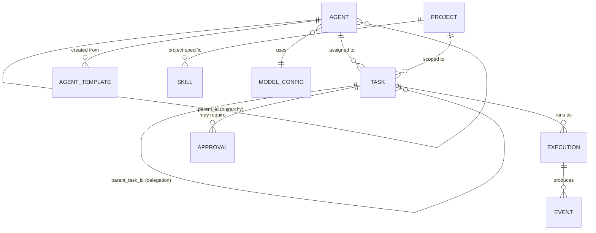

# Domain and Data Model

## 1. Entity Overview



---

## 2. Core Entities

### 2.1 Agent

**Type: Persistent domain entity**

Represents a configured AI agent with identity, role, capabilities, and hierarchy position.

```python
@dataclass
class Agent:
    # Identity
    id: str                              # Unique identifier (slug from name)
    name: str                            # Human-readable name
    description: Optional[str]           # Role description
    avatar: Optional[str]                # Pixel art character reference

    # Hierarchy (NEW)
    parent_id: Optional[str]             # ID of parent/manager agent (NULL for root)
    role_type: AgentRole                 # root_orchestrator | manager | worker | specialist
    department: str                      # Grouping for office layout

    # Configuration
    system_prompt: str                   # Agent's instruction prompt
    model: str                           # Model identifier (e.g., "sonnet", "opus")
    effort: str                          # Execution effort level
    max_tokens: int                      # Max output tokens
    temperature: float                   # Sampling temperature

    # Capabilities (NEW)
    skills: List[str]                    # Skill IDs this agent has access to
    allowed_tools: List[str]             # Tool permissions (NEW - enforced)
    max_concurrent_children: int         # Max simultaneous child executions
    delegation_strategy: str             # "explicit" | "auto"
    allowed_child_ids: Optional[List[str]]  # Specific children this agent can delegate to

    # Context
    repo_path: Optional[str]             # Default working directory
    github_url: Optional[str]            # Associated repository

    # Metadata
    created_at: datetime
    updated_at: datetime
```

**Existing fields preserved**: id, name, description, system_prompt, skills, model, effort, max_tokens, temperature, repo_path, github_url, department, avatar

**New fields**: parent_id, role_type, max_concurrent_children, delegation_strategy, allowed_child_ids, allowed_tools (moved from Project to Agent)

### 2.2 Agent Hierarchy

**Type: Derived from Agent.parent_id**

Not a separate entity — derived by traversing `parent_id` references.

```
Root Orchestrator (parent_id = NULL)
├── Engineering Manager (parent_id = root)
│   ├── Coding Agent (parent_id = eng_mgr)
│   ├── Testing Agent (parent_id = eng_mgr)
│   └── Review Agent (parent_id = eng_mgr)
├── Research Manager (parent_id = root)
│   └── Research Agent (parent_id = research_mgr)
└── QA Manager (parent_id = root)
    └── Accessibility Agent (parent_id = qa_mgr)
```

**Constraints**:
- Maximum depth: configurable (default 3)
- An agent can have at most one parent
- No circular references
- `role_type` must be consistent: workers cannot have children

### 2.3 Task

**Type: Persistent domain entity**

Represents a unit of work assigned to an agent, potentially part of a delegation chain.

```python
@dataclass
class Task:
    # Identity
    id: str                              # UUID
    prompt: str                          # Task description / instruction

    # Assignment
    agent_id: str                        # Agent responsible for this task
    project_id: Optional[str]            # Project scope
    assigned_by: Optional[str]           # Agent ID that delegated this task (NEW)

    # Hierarchy (NEW)
    parent_task_id: Optional[str]        # Parent task in delegation chain (NULL for root)
    root_task_id: Optional[str]          # Original root task ID (for tracing)
    delegation_depth: int                # How many levels deep (0 = root task)

    # Status
    status: TaskStatus                   # queued | assigned | running | waiting |
                                         # completed | failed | cancelled
    priority: int                        # Execution priority (NEW)

    # Input/Output
    input_data: Optional[Dict]           # Structured input
    output_data: Optional[Dict]          # Structured output
    result: Optional[str]                # Text result
    error: Optional[str]                 # Error message if failed

    # Lifecycle
    created_at: datetime
    started_at: Optional[datetime]
    ended_at: Optional[datetime]

    # Execution reference
    execution_id: Optional[str]          # Links to active Execution (NEW)
```

**Task Status Extended**:
```python
class TaskStatus(Enum):
    QUEUED = "queued"                 # Waiting to be assigned
    ASSIGNED = "assigned"            # Assigned to agent, not yet started (NEW)
    RUNNING = "running"              # Active execution
    WAITING_FOR_CHILDREN = "waiting" # Manager waiting for sub-tasks (NEW)
    WAITING_FOR_APPROVAL = "pending_approval"  # Needs human approval (NEW)
    COMPLETED = "completed"
    FAILED = "failed"
    CANCELLED = "cancelled"
```

### 2.4 Execution

**Type: Transient runtime state + persisted record**

Represents a single runtime execution (subprocess) of a task.

```python
@dataclass
class Execution:
    # Identity
    id: str                              # UUID (maps to existing run_id)
    task_id: str                         # Which task this executes
    agent_id: str                        # Which agent is executing

    # Runtime
    runtime_type: str                    # "claude_code" | "direct_api" | "mock"
    session_id: Optional[str]            # Claude Code session ID (for resume)
    process_id: Optional[int]            # OS process ID (transient)

    # Status
    status: ExecutionStatus              # starting | running | completed | failed | cancelled
    exit_code: Optional[int]

    # Lifecycle
    created_at: datetime
    started_at: Optional[datetime]
    ended_at: Optional[datetime]

    # Results
    result: Optional[str]
    error: Optional[str]
    events_count: int                    # Number of events produced
```

**Distinction from Task**: A Task is a business-level assignment. An Execution is a runtime-level process. A Task may have multiple Executions (retries), but typically one active Execution at a time.

### 2.5 Session

**Type: Transient runtime state**

Represents a Claude Code session that may span multiple prompts.

```python
@dataclass
class Session:
    id: str                              # Claude Code session ID
    agent_id: str
    project_id: Optional[str]
    created_at: datetime
    last_active: datetime
    is_active: bool
    execution_count: int                 # How many executions in this session
```

> [!NOTE]
> Sessions are primarily a Claude Code concept. The platform tracks them for resume/fork capability, but they are not the primary unit of work (Tasks are).

### 2.6 Runtime

**Type: Configuration entity**

Represents a configured runtime backend.

```python
@dataclass
class RuntimeConfig:
    id: str                              # e.g., "claude_code_fcc"
    name: str                            # "Free Claude Code"
    adapter_type: str                    # "claude_code" | "direct_api" | "nvidia_nim"
    configuration: Dict[str, Any]        # Adapter-specific config
    is_default: bool
    capabilities: RuntimeCapabilities    # What this runtime supports
```

### 2.7 Model Configuration

**Type: Persistent configuration entity**

```python
@dataclass
class ModelConfig:
    id: str                              # e.g., "sonnet", "opus", "fable"
    name: str                            # Display name
    provider: str                        # "anthropic" | "nvidia" | "custom"
    runtime_id: str                      # Which runtime adapter handles this model
    model_identifier: str                # Actual model string passed to runtime
    supports_tool_use: bool
    supports_streaming: bool
    max_context_window: Optional[int]
    description: Optional[str]
```

### 2.8 Tool Permissions

**Type: Configuration entity (embedded in Agent and Project)**

```python
@dataclass
class ToolPermission:
    tool_id: str                         # e.g., "filesystem_read", "filesystem_write", "shell"
    granted: bool
    restrictions: Optional[Dict]         # e.g., {"paths": ["/src/"], "commands": ["npm test"]}
```

### 2.9 Workspace / Project

**Type: Persistent domain entity (extends existing ProjectConfig)**

```python
@dataclass
class Project:
    # Existing fields
    id: str
    name: str
    description: str
    working_directory: str               # Filesystem path for agent execution
    instructions: Optional[str]          # Project-level instructions appended to prompts
    skills: List[str]                    # Skill IDs available in this project
    allowed_tools: List[str]             # Default tool permissions for this project

    # New fields
    default_agent_id: Optional[str]      # Default root agent for this project
    runtime_id: Optional[str]            # Override runtime for this project
    environment_vars: Dict[str, str]     # Additional env vars (names only, values from secrets)

    # Metadata
    created_at: datetime
    updated_at: datetime
```

### 2.10 Event

**Type: Persistent append-only log entry**

```python
@dataclass
class Event:
    # Identity
    id: str                              # UUID
    sequence_number: int                 # Monotonically increasing
    event_type: str                      # Dot-notation type (e.g., "task.started")

    # Context
    agent_id: Optional[str]
    task_id: Optional[str]
    execution_id: Optional[str]
    parent_task_id: Optional[str]
    project_id: Optional[str]

    # Content
    payload: Dict[str, Any]              # Event-type-specific data
    timestamp: datetime

    # Metadata
    source: str                          # "runtime" | "orchestrator" | "api" | "user"
```

### 2.11 Result

**Type: Embedded in Task (not a separate entity)**

Results are stored as `Task.result` (text) and `Task.output_data` (structured). When a child task completes, its result is forwarded through the delegation chain via the orchestrator.

### 2.12 Approval

**Type: Persistent domain entity (NEW)**

```python
@dataclass
class Approval:
    id: str                              # UUID
    task_id: str                         # Task requiring approval
    agent_id: str                        # Agent that triggered the approval
    reason: str                          # Why approval is needed
    requested_action: str                # What the agent wants to do
    status: ApprovalStatus               # pending | approved | denied | expired
    requested_at: datetime
    resolved_at: Optional[datetime]
    resolved_by: Optional[str]           # User who approved/denied
    timeout_seconds: Optional[int]       # Auto-expire after timeout
```

### 2.13 Agent Template

**Type: Persistent configuration entity (NEW)**

```python
@dataclass
class AgentTemplate:
    id: str
    name: str                            # e.g., "Engineering Manager"
    description: str
    role_type: AgentRole
    system_prompt: str
    default_model: str
    default_skills: List[str]
    default_tools: List[str]
    suggested_children: List[str]        # Template IDs for suggested child agents
    category: str                        # "engineering" | "qa" | "research" | etc.
    is_builtin: bool                     # True for platform-provided templates
```

---

## 3. Persistent vs Transient State

| Entity | Storage | Lifecycle |
|--------|---------|-----------|
| Agent | SQLite `agents` table | Persistent until deleted |
| Project | SQLite `projects` table | Persistent until deleted |
| Skill | SQLite `skills` table + filesystem | Persistent until deleted |
| Task | SQLite `tasks` table | Persistent (historical record) |
| Execution | SQLite `executions` table + in-memory | Persisted on completion, live in memory during run |
| Event | SQLite `event_log` table | Persistent append-only |
| Session | In-memory + optional persistence | Transient, tracked for resume |
| Approval | SQLite `approvals` table | Persistent until resolved |
| AgentTemplate | SQLite `agent_templates` table | Persistent configuration |
| RuntimeConfig | Configuration file or DB | Persistent configuration |
| ModelConfig | Configuration file or DB | Persistent configuration |
| Process state | In-memory (`_processes` dict) | Transient, lost on restart |
| Event subscriptions | In-memory | Transient, lost on restart |

---

## 4. Database Schema (SQLite)

### 4.1 Extended `agents` Table

```sql
CREATE TABLE IF NOT EXISTS agents (
    -- Existing columns (preserved)
    id TEXT PRIMARY KEY,
    name TEXT NOT NULL,
    description TEXT,
    system_prompt TEXT NOT NULL,
    skills TEXT,              -- JSON array
    model TEXT DEFAULT 'default',
    effort TEXT DEFAULT 'medium',
    max_tokens INTEGER DEFAULT 8000,
    temperature REAL DEFAULT 0.7,
    repo_path TEXT,
    github_url TEXT,
    department TEXT DEFAULT 'Engineering',
    avatar TEXT,
    created_at TIMESTAMP DEFAULT CURRENT_TIMESTAMP,
    updated_at TIMESTAMP DEFAULT CURRENT_TIMESTAMP,

    -- New columns
    parent_id TEXT,                       -- FK to agents.id
    role_type TEXT DEFAULT 'worker',      -- root_orchestrator | manager | worker | specialist
    max_concurrent_children INTEGER DEFAULT 3,
    delegation_strategy TEXT DEFAULT 'explicit',
    allowed_child_ids TEXT,              -- JSON array of agent IDs
    allowed_tools TEXT,                  -- JSON array of tool permissions
    template_id TEXT,                    -- FK to agent_templates.id

    FOREIGN KEY (parent_id) REFERENCES agents (id) ON DELETE SET NULL
);
```

### 4.2 Extended `task_runs` Table (renamed to `tasks`)

```sql
CREATE TABLE IF NOT EXISTS tasks (
    id TEXT PRIMARY KEY,                 -- Was run_id
    agent_id TEXT NOT NULL,
    project_id TEXT,
    prompt TEXT NOT NULL,
    status TEXT NOT NULL,
    priority INTEGER DEFAULT 0,

    -- Delegation chain (NEW)
    parent_task_id TEXT,                 -- FK to tasks.id
    root_task_id TEXT,                   -- FK to tasks.id (top-level task)
    assigned_by TEXT,                    -- Agent ID that delegated
    delegation_depth INTEGER DEFAULT 0,

    -- Results
    input_data TEXT,                     -- JSON
    output_data TEXT,                    -- JSON
    result TEXT,
    error TEXT,
    exit_code INTEGER,

    -- Lifecycle
    created_at TIMESTAMP NOT NULL,
    started_at TIMESTAMP,
    ended_at TIMESTAMP,

    -- Execution reference
    execution_id TEXT,                   -- FK to executions.id

    FOREIGN KEY (agent_id) REFERENCES agents (id),
    FOREIGN KEY (project_id) REFERENCES projects (id),
    FOREIGN KEY (parent_task_id) REFERENCES tasks (id),
    FOREIGN KEY (root_task_id) REFERENCES tasks (id)
);
```

### 4.3 New `event_log` Table

```sql
CREATE TABLE IF NOT EXISTS event_log (
    id TEXT PRIMARY KEY,
    sequence_number INTEGER NOT NULL,    -- Auto-increment within scope
    event_type TEXT NOT NULL,
    agent_id TEXT,
    task_id TEXT,
    execution_id TEXT,
    parent_task_id TEXT,
    project_id TEXT,
    payload TEXT,                        -- JSON
    source TEXT NOT NULL,                -- runtime | orchestrator | api | user
    timestamp TIMESTAMP NOT NULL,

    FOREIGN KEY (agent_id) REFERENCES agents (id),
    FOREIGN KEY (task_id) REFERENCES tasks (id)
);

CREATE INDEX IF NOT EXISTS idx_events_type ON event_log(event_type);
CREATE INDEX IF NOT EXISTS idx_events_agent ON event_log(agent_id);
CREATE INDEX IF NOT EXISTS idx_events_task ON event_log(task_id);
CREATE INDEX IF NOT EXISTS idx_events_timestamp ON event_log(timestamp);
CREATE INDEX IF NOT EXISTS idx_events_sequence ON event_log(sequence_number);
```

### 4.4 New `approvals` Table

```sql
CREATE TABLE IF NOT EXISTS approvals (
    id TEXT PRIMARY KEY,
    task_id TEXT NOT NULL,
    agent_id TEXT NOT NULL,
    reason TEXT NOT NULL,
    requested_action TEXT,
    status TEXT NOT NULL DEFAULT 'pending',  -- pending | approved | denied | expired
    requested_at TIMESTAMP NOT NULL,
    resolved_at TIMESTAMP,
    resolved_by TEXT,
    timeout_seconds INTEGER,

    FOREIGN KEY (task_id) REFERENCES tasks (id),
    FOREIGN KEY (agent_id) REFERENCES agents (id)
);
```

### 4.5 New `agent_templates` Table

```sql
CREATE TABLE IF NOT EXISTS agent_templates (
    id TEXT PRIMARY KEY,
    name TEXT NOT NULL,
    description TEXT,
    role_type TEXT NOT NULL,
    system_prompt TEXT NOT NULL,
    default_model TEXT DEFAULT 'default',
    default_skills TEXT,                -- JSON array
    default_tools TEXT,                 -- JSON array
    suggested_children TEXT,            -- JSON array of template IDs
    category TEXT,
    is_builtin BOOLEAN DEFAULT 0,
    created_at TIMESTAMP DEFAULT CURRENT_TIMESTAMP,
    updated_at TIMESTAMP DEFAULT CURRENT_TIMESTAMP
);
```

---

## 5. Key Relationships

```
Agent (1) ──parent_id──> Agent (0..1)          # Hierarchy
Agent (1) ──────────────> Task (0..*)           # Assignment
Task (1) ──parent_task_id──> Task (0..1)       # Delegation chain
Task (1) ──────────────> Execution (0..*)       # May have retries
Execution (1) ──────────> Event (0..*)          # Produces events
Task (1) ──────────────> Approval (0..*)        # May need approval
Agent (0..1) ──template_id──> AgentTemplate (0..1)  # Created from template
Project (1) ──────────> Task (0..*)             # Scoped to project
Project (1) ──────────> Skill (0..*)            # Project-specific skills
```

---

## 6. Migration Path from Current Schema

| Current | Target | Migration Strategy |
|---------|--------|-------------------|
| `agents` table (14 columns) | `agents` table (21 columns) | `ALTER TABLE ADD COLUMN` for 7 new columns |
| `task_runs` table | `tasks` table | Rename + `ALTER TABLE ADD COLUMN` for delegation fields |
| `task_runs.events` (JSON blob) | `event_log` table | New table; migrate historical events in background |
| No approvals | `approvals` table | New table |
| No templates | `agent_templates` table | New table; seed with default templates |
| `projects` table | `projects` table | Add `default_agent_id`, `runtime_id`, `environment_vars` |
| `skills` table | `skills` table | No changes needed |
