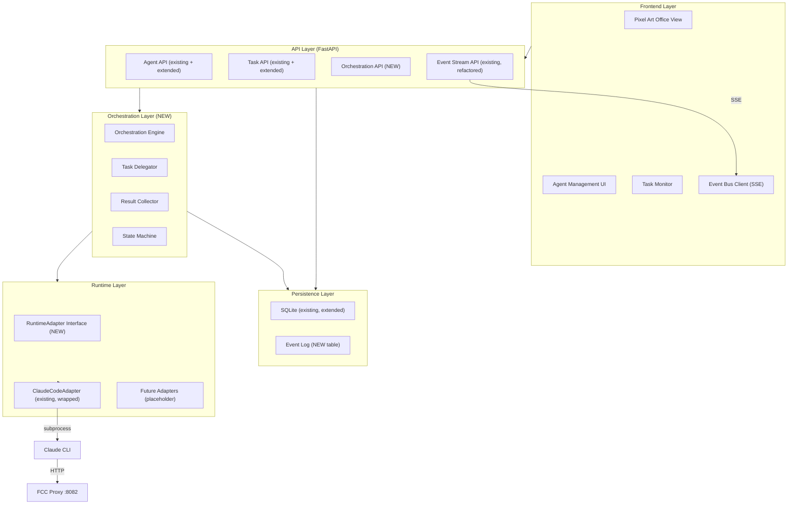
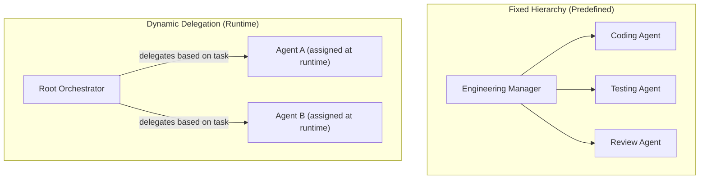
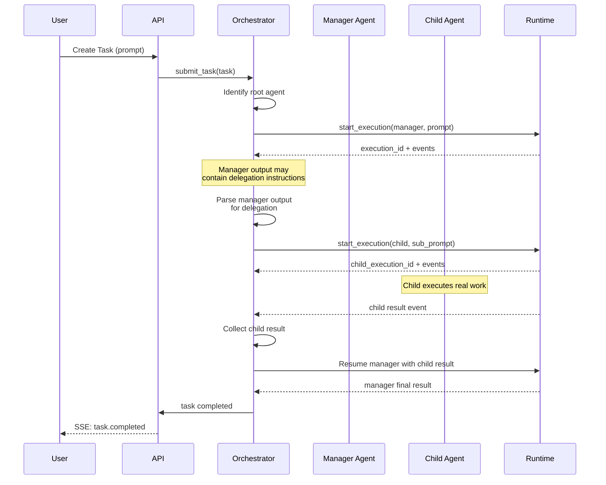
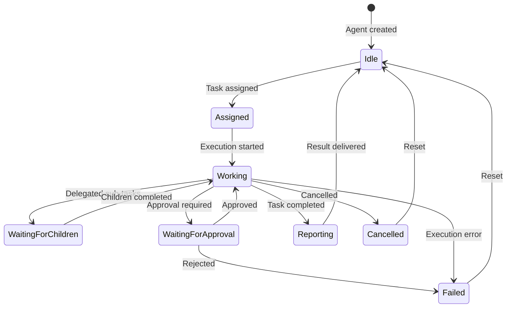

# Target Architecture — AI Agents Office Platform

## 1. System Architecture Overview

The target architecture extends the existing POC by adding three new layers above the verified runtime adapter, while preserving all existing functionality.



---

## 2. Module Boundaries

### 2.1 Existing Modules (Preserved)

| Module | Responsibility | Changes |
|--------|---------------|---------|
| `config.py` | Agent/Project/Skill configuration | Extend `AgentConfig` with hierarchy fields |
| `persistence.py` | SQLite CRUD | Add hierarchy columns, event log table |
| `runtime_adapter.py` | Claude Code subprocess management | Remove mock fallback, implement `RuntimeAdapter` protocol |
| `backend/api/agents.py` | Agent CRUD API | Add hierarchy endpoints |
| `backend/api/tasks.py` | Task management + SSE | Refactor SSE, add global event stream |
| `backend/api/events.py` | System stats | Replace mock WS with real event aggregation |
| `backend/api/projects.py` | Project CRUD API | Minor extensions |
| `backend/api/skills.py` | Skill CRUD API | No changes needed |

### 2.2 New Modules

| Module | Responsibility | Location |
|--------|---------------|----------|
| `orchestration/engine.py` | Task delegation, hierarchy traversal, result collection | `poc/orchestration/` |
| `orchestration/state_machine.py` | Agent lifecycle state transitions | `poc/orchestration/` |
| `orchestration/delegator.py` | Manager-to-child task assignment | `poc/orchestration/` |
| `runtime/protocol.py` | `RuntimeAdapter` protocol definition | `poc/runtime/` |
| `runtime/claude_adapter.py` | Existing adapter wrapped with protocol | `poc/runtime/` |
| `events/bus.py` | In-process event bus for global event aggregation | `poc/events/` |
| `events/models.py` | Typed event definitions | `poc/events/` |
| `backend/api/orchestration.py` | Orchestration API endpoints | `poc/backend/api/` |

---

## 3. Runtime Adapter Strategy

### 3.1 Design Decision: Wrap, Don't Replace

The existing `ClaudeCodeRuntimeAdapter` is verified to work. The strategy is:

1. **Extract a protocol** from the existing adapter's public API
2. **Wrap** the existing adapter to conform to the protocol
3. **Add** orchestration awareness above the adapter
4. **Future**: implement additional adapters for direct API calls, NVIDIA NIM, etc.

### 3.2 RuntimeAdapter Protocol

```python
from typing import Protocol, Optional, Callable, Dict, Any, List

class RuntimeAdapter(Protocol):
    """Interface for AI runtime execution backends."""

    def start_execution(
        self,
        agent_config: AgentConfig,
        project_config: Optional[ProjectConfig],
        prompt: str,
        session_id: Optional[str] = None,
    ) -> str:
        """Start an execution. Returns execution_id."""
        ...

    def get_execution_status(self, execution_id: str) -> Optional[ExecutionStatus]:
        """Get current status of an execution."""
        ...

    def cancel_execution(self, execution_id: str) -> bool:
        """Cancel a running execution."""
        ...

    def subscribe_to_events(
        self,
        execution_id: str,
        handler: Callable[[RuntimeEvent], None]
    ) -> Callable[[], None]:
        """Subscribe to execution events. Returns unsubscribe function."""
        ...

    def get_capabilities(self) -> RuntimeCapabilities:
        """Report what this runtime supports."""
        ...
```

### 3.3 RuntimeCapabilities

```python
@dataclass
class RuntimeCapabilities:
    supports_streaming: bool
    supports_tool_use: bool
    supports_session_resume: bool
    supports_cancellation: bool
    supports_concurrent: bool
    max_concurrent: Optional[int]
    supported_models: List[str]
```

### 3.4 ClaudeCodeAdapter (Wrapped)

The existing `ClaudeCodeRuntimeAdapter` becomes the first implementation of `RuntimeAdapter`:

```python
class ClaudeCodeAdapter:
    """Wraps existing ClaudeCodeRuntimeAdapter with the RuntimeAdapter protocol."""

    def __init__(self, existing_adapter: ClaudeCodeRuntimeAdapter):
        self._adapter = existing_adapter

    def start_execution(self, agent_config, project_config, prompt, session_id=None):
        return self._adapter.start_task(
            agent_id=agent_config.id,
            project_id=project_config.id if project_config else None,
            prompt=prompt,
            session_id=session_id
        )

    def get_capabilities(self) -> RuntimeCapabilities:
        return RuntimeCapabilities(
            supports_streaming=True,
            supports_tool_use=True,      # Via Claude Code's tool system
            supports_session_resume=True, # --resume flag
            supports_cancellation=True,   # process.terminate()
            supports_concurrent=True,     # Thread-per-run
            max_concurrent=None,          # Not enforced yet
            supported_models=["default", "sonnet", "opus", "haiku", "fable"]
        )
```

### 3.5 Future Adapter Considerations

| Adapter | When to Build | Prerequisite |
|---------|--------------|--------------|
| `DirectClaudeAPIAdapter` | When bypassing FCC proxy is needed | Anthropic API key |
| `NVIDIANIMAdapter` | When NVIDIA models need different tool/streaming formats | NVIDIA NIM access |
| `MockAdapter` | Immediately (for testing) | None — but must be clearly labeled |

---

## 4. Orchestration Model

### 4.1 Hierarchy Types



### 4.2 Orchestration Engine Responsibilities

| Responsibility | Description |
|---------------|-------------|
| **Task Decomposition** | Accept a high-level task and determine which agent(s) should handle it |
| **Delegation** | Assign sub-tasks to child agents via the runtime adapter |
| **Result Collection** | Gather results from child agents and forward to parent |
| **State Tracking** | Maintain orchestration state across agent hierarchy |
| **Failure Handling** | Detect child failures and decide: retry, escalate, or abort |
| **Concurrency Control** | Enforce limits on concurrent child executions |
| **Timeout Enforcement** | Cancel child tasks that exceed time limits |
| **Approval Gates** | Pause execution and wait for human approval before sensitive operations |

### 4.3 Orchestration Flow



### 4.4 Who Decides What

| Decision | Decided By | Mechanism |
|----------|-----------|-----------|
| Which agent handles a task | Orchestrator (fixed hierarchy) or Manager Agent (dynamic) | Configuration or model output parsing |
| What tools an agent can use | Platform configuration | `AgentConfig.allowed_tools` (to be enforced) |
| When to stop/retry | Orchestrator | Configurable retry policy |
| When to escalate | Orchestrator | Failure count threshold |
| Sensitive operation approval | Human via UI | Approval gate in orchestration flow |
| Which model to use | Agent configuration | `AgentConfig.model` per agent |

---

## 5. Agent Hierarchy Design

### 5.1 Agent Types

```python
class AgentRole(Enum):
    ROOT_ORCHESTRATOR = "root_orchestrator"  # Top-level coordinator
    MANAGER = "manager"                      # Delegates to children
    WORKER = "worker"                        # Executes tasks directly
    SPECIALIST = "specialist"                # Worker with specific expertise
```

### 5.2 Hierarchy Rules

1. A `ROOT_ORCHESTRATOR` has no parent
2. A `MANAGER` can be a child of `ROOT_ORCHESTRATOR` or another `MANAGER`
3. A `WORKER` or `SPECIALIST` must be a child of a `MANAGER`
4. Maximum hierarchy depth: configurable (default: 3)
5. An agent can have at most one parent
6. An agent can have multiple children

### 5.3 AgentConfig Extension

```python
@dataclass
class AgentConfig:
    # ... existing fields ...
    parent_id: Optional[str] = None
    role_type: AgentRole = AgentRole.WORKER
    max_concurrent_children: int = 3
    delegation_strategy: str = "explicit"  # "explicit" | "auto"
    allowed_child_ids: Optional[List[str]] = None
```

---

## 6. Event and State Architecture

### 6.1 State Model



### 6.2 Event Types

```python
class EventType(Enum):
    # Agent lifecycle
    AGENT_CREATED = "agent.created"
    AGENT_UPDATED = "agent.updated"
    AGENT_DELETED = "agent.deleted"

    # Task lifecycle
    TASK_CREATED = "task.created"
    TASK_ASSIGNED = "task.assigned"
    TASK_QUEUED = "task.queued"
    TASK_STARTED = "task.started"
    TASK_DELEGATED = "task.delegated"

    # Execution events
    EXECUTION_STARTED = "execution.started"
    EXECUTION_THOUGHT = "execution.thought"
    EXECUTION_TOOL_START = "execution.tool.start"
    EXECUTION_TOOL_END = "execution.tool.end"
    EXECUTION_OUTPUT = "execution.output"

    # Completion events
    TASK_COMPLETED = "task.completed"
    TASK_FAILED = "task.failed"
    TASK_CANCELLED = "task.cancelled"
    RESULT_SUBMITTED = "result.submitted"
    RESULT_FORWARDED = "result.forwarded"

    # Approval events
    APPROVAL_REQUIRED = "approval.required"
    APPROVAL_GRANTED = "approval.granted"
    APPROVAL_DENIED = "approval.denied"
```

### 6.3 Event Structure

```python
@dataclass
class PlatformEvent:
    event_id: str           # UUID
    event_type: EventType
    timestamp: datetime
    agent_id: Optional[str]
    task_id: Optional[str]
    parent_task_id: Optional[str]
    session_id: Optional[str]
    execution_id: Optional[str]
    payload: Dict[str, Any]  # Event-type-specific data
    sequence_number: int     # Monotonically increasing per session
```

### 6.4 Event Bus (In-Process)

```python
class EventBus:
    """In-process event bus. No external message broker needed."""

    def __init__(self):
        self._subscribers: Dict[str, List[Callable]] = {}
        self._global_subscribers: List[Callable] = []
        self._event_log: List[PlatformEvent] = []

    def publish(self, event: PlatformEvent):
        """Publish event to all relevant subscribers."""
        self._event_log.append(event)
        self._persist_event(event)
        for handler in self._global_subscribers:
            handler(event)
        if event.agent_id and event.agent_id in self._subscribers:
            for handler in self._subscribers[event.agent_id]:
                handler(event)

    def subscribe_global(self, handler: Callable) -> Callable[[], None]:
        """Subscribe to all events. Returns unsubscribe function."""
        ...

    def subscribe_agent(self, agent_id: str, handler: Callable) -> Callable[[], None]:
        """Subscribe to events for a specific agent."""
        ...

    def replay(self, since: Optional[datetime] = None) -> List[PlatformEvent]:
        """Replay events from the event log."""
        ...
```

### 6.5 State vs Events Distinction

| Concept | Storage | Purpose |
|---------|---------|---------|
| **Desired state** | `tasks` table | What should happen (task assignment) |
| **Actual state** | `agent_states` in-memory + DB | What is happening (execution status) |
| **Events** | `event_log` table | What happened (audit trail, replay) |
| **Live delivery** | SSE via EventBus | Real-time UI updates |
| **Historical replay** | `event_log` table query | Reconnection, debugging |

### 6.6 SSE Architecture (Refactored)

Replace per-task SSE with a global event stream:

```
GET /api/v1/events/stream
    ?agent_id=xxx           (optional: filter by agent)
    &task_id=xxx            (optional: filter by task)
    &since=<timestamp>      (optional: replay from timestamp)

SSE event format:
event: task.started
data: {"event_id":"...","agent_id":"...","task_id":"...","payload":{...}}
```

---

## 7. Persistence Strategy

### 7.1 Keep SQLite

SQLite is appropriate for the current scale. No need for PostgreSQL or Redis unless:
- More than ~50 concurrent agent executions
- Multi-server deployment required
- Real-time pub/sub across processes needed

### 7.2 Schema Extensions

New tables:
- `event_log` — normalized event storage (replaces JSON blob in task_runs)
- `agent_templates` — reusable agent definitions
- `approvals` — human approval requests and responses

Modified tables:
- `agents` — add `parent_id`, `role_type`, `max_concurrent_children`
- `task_runs` — add `parent_task_id`, `assigned_by`, `delegation_chain`

### 7.3 Migration Strategy

Use incremental `ALTER TABLE` with the existing pattern already established in [`persistence.py` L67-76](file:///c:/Users/taguo/Desktop/ai-agents-platform/poc/persistence.py#L67-L76):

```python
# Existing pattern — extend this approach
for col, col_type in [
    ("parent_id", "TEXT"),
    ("role_type", "TEXT DEFAULT 'worker'"),
    ("max_concurrent_children", "INTEGER DEFAULT 3"),
]:
    try:
        conn.execute(f"ALTER TABLE agents ADD COLUMN {col} {col_type}")
    except Exception:
        pass
```

---

## 8. Integration Strategy

### 8.1 External Tool Integrations

Design tool integrations as **capabilities** that agents reference, not hardcoded behavior:

```python
@dataclass
class ToolIntegration:
    id: str                     # e.g., "github", "jira", "filesystem"
    name: str
    required_credentials: List[str]  # Environment variable names
    permission_scope: str       # "read", "write", "admin"
    configuration: Dict[str, Any]
```

Tool permissions are enforced at the orchestration level:
- Agent's `allowed_tools` checked before starting execution
- Credentials injected into subprocess environment only if agent has permission

### 8.2 Credential Management

- Store credential references (env var names), not values
- Credentials provided via environment variables at server startup
- Per-project credential scoping via project configuration
- Never log credential values

---

## 9. Security Boundaries

### 9.1 Permission Model

```
Platform Level
├── Which agents exist
├── Which projects exist
├── Which users can access (future)
│
Agent Level
├── Which tools this agent can use
├── Which projects this agent can access
├── Which child agents it can delegate to
├── Max concurrent executions
│
Project Level
├── Working directory boundary
├── Allowed tools for this project
├── Project-specific skills
├── Project-specific credentials
│
Execution Level
├── Process runs in specific cwd
├── --add-dir restricts file access (Claude Code level)
├── Environment variables controlled per-execution
└── Approval gates for sensitive operations
```

### 9.2 Priority Security Improvements

1. **Remove `--dangerously-skip-permissions`** or make it configurable per-agent
2. **Enforce `allowed_tools`** at the runtime adapter level
3. **Add API authentication** (API key or JWT for initial version)
4. **Remove hardcoded credentials** from source
5. **Add audit logging** for all agent actions

---

## 10. Pixel Art Office UI Architecture

### 10.1 Design Principles

1. **State-driven rendering**: Office visuals are a pure function of backend state
2. **No invented state**: The UI never shows an agent as "working" unless the backend confirms it
3. **Decoupled animation**: Animation engine is separate from business logic
4. **Deterministic mapping**: Every backend event maps to exactly one visual transition

### 10.2 Visual State Machine

```
Backend Event                → Agent Visual State      → Office Behavior
─────────────────────────────────────────────────────────────────────────
agent.created                → IDLE                    → Agent appears at assigned desk
task.assigned                → ASSIGNED                → Brief attention animation
execution.started            → WORKING                 → Typing animation at desk
execution.tool.start         → WORKING (tool overlay)  → Tool icon appears
task.delegated               → WAITING_FOR_CHILDREN    → Thinking/waiting animation
task.completed               → MOVING_TO_MANAGER       → Agent walks to manager desk
result.submitted             → REPORTING               → Speech bubble at manager
result.forwarded             → IDLE                    → Agent walks back to desk
task.failed                  → ERROR                   → Error indicator, red flash
task.cancelled               → IDLE                    → Fade back to idle
```

### 10.3 Rendering Approach

| Option | Pros | Cons | Recommendation |
|--------|------|------|---------------|
| HTML Canvas 2D | Best for pixel art, smooth animations, good performance | No DOM events on sprites, manual hit testing | **RECOMMENDED** for office scene |
| DOM + CSS | Current approach, easy click handlers | Poor pixel art rendering, DOM overhead | Keep for UI panels/overlays |
| WebGL | Best performance for complex scenes | Overkill for 2D pixel art | Not needed |
| SVG | Scalable, DOM events | Not designed for pixel art | Keep for flow diagrams only |

**Hybrid approach**: Canvas for the pixel art office scene, DOM overlays for tooltips, drawers, and control panels.

### 10.4 Asset Requirements

| Asset Category | Examples | Format |
|----------------|----------|--------|
| Agent sprites | Idle, walking (4 directions), sitting, typing, thinking, error | PNG sprite sheets (16x16 or 32x32 base) |
| Furniture | Desks, chairs, monitors, plants, whiteboards | Static PNG tiles |
| Office floor | Tiles, carpet, walkways | Tileable PNG |
| UI elements | Speech bubbles, status icons, progress bars | PNG or Canvas-drawn |
| Effects | Particles, glow, highlights | Canvas-drawn animations |

### 10.5 Office Layout Engine

Replace hardcoded coordinates with a configurable layout:

```typescript
interface OfficeLayout {
  width: number;
  height: number;
  departments: DepartmentLayout[];
}

interface DepartmentLayout {
  id: string;
  name: string;
  area: { x: number; y: number; width: number; height: number };
  desks: DeskPosition[];
  managerDesk: DeskPosition;
}

interface DeskPosition {
  x: number;
  y: number;
  agentId?: string;  // Assigned agent (if any)
}
```

---

## 11. Trade-offs and Alternatives

### 11.1 Orchestration: Application-level vs Runtime-native

**Chosen: Application-level orchestration**

The platform manages the hierarchy and delegation logic, not the model or Claude Code.

*Why*: Runtime-native sub-agents (if Claude Code supports them) are opaque — the platform cannot control permissions, concurrency, or visualization. Application-level orchestration gives full control.

*Trade-off*: More complex to implement, but essential for the security and observability requirements.

### 11.2 Event Bus: In-process vs External

**Chosen: In-process event bus (no Redis/Kafka)**

*Why*: Single-server deployment, SQLite persistence, no need for cross-process pub/sub. The existing system runs as a single Python process.

*Trade-off*: Cannot scale to multiple backend instances. If needed later, the EventBus interface can be swapped for Redis pub/sub without changing the rest of the architecture.

### 11.3 Database: SQLite vs PostgreSQL

**Chosen: Keep SQLite**

*Why*: Already in use, sufficient for POC and single-user scenarios, zero operational overhead.

*Trade-off*: Limited concurrent write performance, no built-in pub/sub (LISTEN/NOTIFY). Migration path to PostgreSQL is straightforward if needed.

### 11.4 Office Rendering: Canvas vs DOM

**Chosen: HTML Canvas for office scene, DOM for overlays**

*Why*: Pixel art is best rendered on canvas. The current DOM approach cannot produce authentic pixel art aesthetics. Canvas provides precise pixel control and good animation performance.

*Trade-off*: Lose built-in DOM event handling on sprites (must implement hit testing). Mitigated by keeping interactive panels as DOM overlays.
