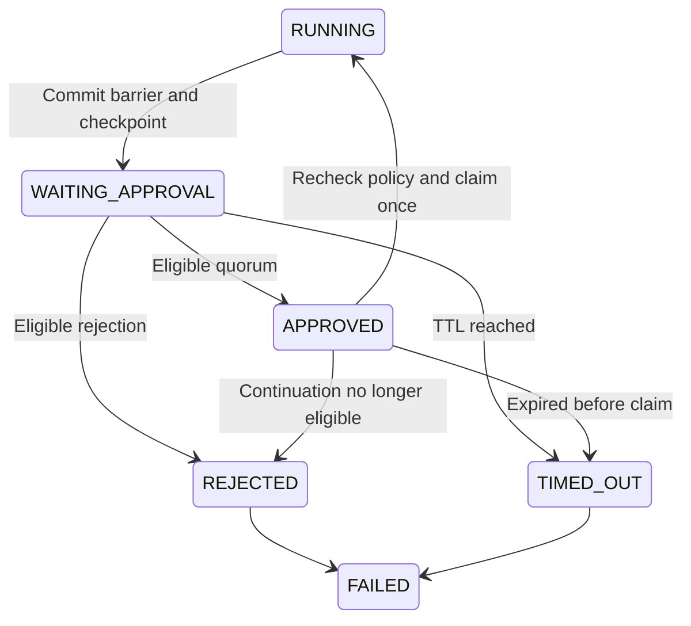

# AI-34–36 · Dashboard DAG approvals

Use `params.dag_approval` to pause a department workflow before dependent work. The approval step is a server barrier with no tool calls. Legacy terminal report and PR approval steps keep their existing contract.

```yaml
steps:
  - key: review
    agent_id: wf-agent-example
    depends_on: [prepare]
    params:
      dag_approval:
        approver_roles: [MANAGER, ORG_ADMIN]
        timeout_seconds: 86400
        quorum: 2
        separate_initiator: true
```

Allowed roles are OPERATOR, MANAGER and ORG_ADMIN. They match the current effective role exactly. Quorum counts distinct eligible personal users, from 1 to 10, and the TTL is 60 to 259200 seconds. The initiating account and the recorded author of the pinned revision cannot decide. Any eligible rejection terminates the wait. Agents must never simulate or self-grant approval.



## Persistence and recovery

The execution and barrier step change to WAITING_APPROVAL in the same transaction as the checkpoint. The checkpoint stores completed outputs, trigger input and aggregate tokens and cost. A ready barrier runs before independent work in the same stage. The sandbox is released during the wait. Continuation recreates the sandbox and skips all checkpointed step keys, using the original revision and frozen integration context. Workflows with a shared source workspace, Playground runs and executions without a personal initiator cannot use this barrier.

The approval and vote tables are authoritative. Votes are unique by approval and personal user. The worker can recover pending or approved-but-unclaimed rows after restart. An approved row is claimed once, with a fresh revision, initiator, voter role and quorum check. The execution and barrier statuses change in that same claim. If a worker stops after claim, inspect the persisted step runs and external receipts before taking recovery action. Automatic replay of a claimed continuation could duplicate effects and is not performed.

The API returns pending requests for the selected department and scopes evidence to executions the caller can read. It exposes bounded prior-output excerpts and recorded cost. Full step details remain in execution logs. Decision submission takes only a boolean and rechecks current authority server-side. Neither an inbox badge nor a prior vote authorizes a subsequent action by itself.
