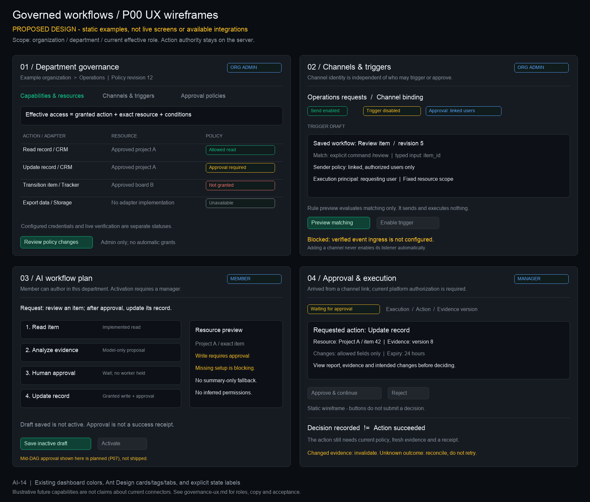

# AI-14: governed workflow UX and role journeys

Status: **P00 design specification**, not shipped UI. No new route, request, grant, listener,
identity link, workflow or provider action is implemented here. Illustrative CRM/Tracker
capabilities below do not imply those adapters exist. Implement only what the current
server catalog describes. [AI-14](https://trello.com/c/EFq5kgnT) depends on
[AI-13](https://trello.com/c/SZTb19BB); [shared contract](../architecture/connector-governance-contract.md).
AI-15 records architecture decisions; P01–P11 own implementation.

[Editable vector wireframes](governance-wireframes.svg). The PNG/SVG are static documentation,
not browser screenshots or an interactive application. Buttons do not make requests.

## 1. Existing source and proposed information architecture

Reuse actual dashboard components/styles rather than inventing a second component system:
`src/App.tsx` Ant Design theme, `OrganizationPage.tsx` tabs, `McpHub.tsx` cards/tags,
`components/robotic/{DepartmentSelect,ModelSelector}`, shared Ant Design controls,
`usePermissions`/`accessPermissions`, existing AuthContext scope and httpClient.
The present robotic directory does not export a RoboticHeader/RoboticCard kit; do not
assume those components exist from historical root documentation.

Existing routes remain `/organization`, `/mcp`, `/workflows`, and
`/workflows/:workflowId/logs?execution=...`. These mockups do not add routes/sidebar items.
Future sections should compose into those surfaces; do not create duplicate settings or
change Office/default navigation as part of this scope (existing AI-5/AI-9 are separate).

| Surface | Proposed section / existing reuse | Implementation owner |
|---|---|---|
| Organization / department | Capabilities & resources; Channels & triggers; Approval policies | P01/P03/P06/P07 |
| MCP Hub | Connector setup, descriptor/tool inspection and separate readiness facts | P02/P03/P05 |
| Account / member area | Verified external identities (self-link; admin revoke) | P04 |
| Workflow authoring | Same action/resource/trigger/approval IR in AI, visual and YAML views | P07/P09 |
| Approval inbox / Workflow Logs | Pending decisions, pinned changes, receipts and recovery | P07/P08/P10 |

Non-admin `/organization` currently renders `DepartmentAccessPage`; future read-only
sections must reuse the authorized data view, not mount the existing administrative
OrganizationPage and issue forbidden user/settings requests. Exact navigation/query
contracts follow implementing tickets; no unregistered endpoint is assumed in this spec.

## 2. Scope, layout and design tokens

Always show organization, selected department and **effective** current role. An admin can
inspect all own-org departments, but any mutation targets one explicit department/resource.
“All departments” is a read overview, not a wildcard mutation target. Foreign tenant names,
resources and policies must not be fetched just to explain an authorization error.

Use existing dark palette: background `#0a0d12`, cards `#161b22`, raised `#1c2128`, border
`#30363d`, primary `#10b981`, text `#f0f6fc`, secondary `#8b949e`. Use existing typography,
8px/16px spacing and Ant Design cards/tabs/tables/drawers. Green signifies confirmed
success/allow, amber waiting/required condition, red denial/failure and gray unavailable.
Every color has a text label/icon; never use color alone as authority or status.

Friendly resource/channel names are primary, with exact immutable IDs accessible via details.
Identifiers, hashes, command snippets and URLs remain LTR within an RTL page. Secrets never
appear in URLs, tooltips, drafts, screenshots, client caches or export payloads.

## 3. Roles and action affordances

The server is authoritative. Frontend flags reduce confusion but cannot grant a capability.
Base rank is capped by current account and selected membership, not a role printed in a JWT.

| Journey | Member | Operator | Manager (effective dept) | Org admin (own org) |
|---|---|---|---|---|
| Read permitted capability/resource directory | Yes | Yes | Yes | Yes |
| Author AI/manual/YAML workflow in own department | Yes | Yes | Yes | Yes |
| Save new workflow | Inactive | Inactive | Existing manager behavior; preview states explicit | Existing admin behavior; scope explicit |
| Activate/edit/delete managed workflow | No | No | Authorized department | Own org; target dept explicit |
| Start an authorized execution | No by base role | Granted operation only | Granted operation only | Granted operation only |
| Change connector credentials, capability grants or channel policy | No | No | No by base role | Authorized admin only |
| Link own external identity | Planned proved self-service | Same | Same | Same |
| Approve sensitive action | No by base role | No by base role | Current role plus approval policy/evidence | Current role plus approval policy/evidence |
| Read/reconcile audit | Authorized records only; no write | Same | Explicitly allowed actions | Explicitly allowed actions |

Current approval endpoints require personal manager/admin; future approval policy may
further restrict approvers/quorum/separation-of-duties. Admin is not a cross-organization
superuser and cannot bypass an action's required policy/evidence checks. Group membership
never fills any row of this matrix on its own.

Hide admin-only configuration actions from ordinary members; explain permissions in a
read-only directory. Show a disabled action with a specific inline reason when it is relevant
to the user's task (e.g. Member's Activate or a manager's incomplete approval evidence).
Do not replace the requested workflow with a weaker one unless the user explicitly agrees.

## 4. Screen 01 — capabilities and resources

Header: department breadcrumb, effective role, policy revision, refresh. Tabs: Capabilities &
resources / Channels & triggers / Approval policies. Use a readable action table:

- Action name from a trusted descriptor, adapter name, effect (read/write/destructive).
- Exact authorized resources/constraints, base grant state and required conditions.
- Separate implementation/credential/policy/provider-verification facts, not one green badge.
- Admin edit drawer previews old/new scope, newly allowed writes, approval requirement and
  optimistic-concurrency revision before explicit save. No “grant all” silent default.

Default examples in the wireframe are hypothetical Read record, Update record, Transition
item and Export data. The form is descriptor-driven, not a hardcoded PR form. Unsupported
capabilities are explanatory/unselectable and cannot become runnable by editing JSON.

Proposed readiness facets: `implementation supported`, `credentials configured`,
`current policy authorized`, `provider verified at <time>`, `currently unavailable`.
Verification staleness is visible. Current CONNECTED and execution_supported values do
not populate “provider verified.” Missing facts remain unknown, not healthy.

## 5. Screen 02 — channels and triggers

Binding card: friendly name + exact provider/channel/connector, department, enabled state,
and independent Send / Trigger / Approval uses. Enabling Send never enables the other two.
Selecting Approval points to a policy; it does not identify every channel member as an approver.

Trigger editor selects a saved workflow/revision and explicit command/mention, typed input
mapping, sender policy, execution principal, resource ceiling, budget/rate/concurrency limits.
Three sender policies must be explained before enablement:

1. Linked, currently authorized platform users (default).
2. Explicit allowed provider subjects under a defined execution policy.
3. Group requests, explicitly enabled with a restricted service principal and fixed scope.

The third policy permits a **request**, not a human approval or organization membership.
No anonymous/bot identity is silently mapped to a platform account. Preview matching uses
bounded local/sample input and/or a future server validation endpoint; it never runs an
agent, invokes a provider, grants permissions or sends a notification. Actual provider
verification is a separate explicitly authorized action.

“Enable trigger” remains blocked until supported verified ingress, binding, principal,
current grants and workflow activation prerequisites are present. Display the specific
blocker; no implication that entering a webhook URL configured the provider or listener.

## 6. Screen 03 — authoring and activation

AI/manual/YAML expose one plan: typed actions, resources, transforms/conditions/bounded
iteration, trigger and approval nodes. Read/write effects and missing capabilities are
visible before save. The AI proposes; the user saves; the server validates current scope.

Example generic request: “Read the item, review its evidence and, after a manager approves,
update the allowed fields.” Show Read → Analyze → Human approval → Update, with an explicit
**planned mid-DAG continuation** badge until P07 exists. Do not claim PR27 supports it today.

Member can save an inactive plan; activation/run controls follow the role matrix. Recovery
must restore only the user's authorized draft/revision. A missing capability/setup yields a
specific clarification with “Keep requested plan / Configure prerequisites / Explicitly revise
request” choices; do not auto-switch to summary-only or silently remove a gate.

Separate save readiness from run readiness. A valid non-executable draft can retain unresolved
requirements only under a future explicit draft contract; it must never become an active
workflow. Existing creation contracts continue to apply until that extension ships.

## 7. Screen 04 — approval and actual execution outcome

Show execution/approval/action IDs, policy/workflow revisions, resource identity, intended
changes, evidence version/hash, report, actual authorized approver and expiry/quorum if
implemented. Keep action-specific details in descriptor/adapter panels: a PR shows SHAs;
a CRM update shows record version and permitted field diff. Core layout stays the same.

A forwarded Telegram/Slack link opens authenticated scoped UI; it is not a bearer permission.
If not signed in, preserve only a safe same-origin return location, never tokens or authority.
Channel-native buttons are explicitly planned until verified identity/callback support ships.

Approve and Reject both require an explicit decision confirmation and current authority.
If evidence changed, expire/invalidate the old decision and request a fresh review. During
resolution, disable repeat submission and poll authoritative status. Role loss while open
removes mutation affordances and clears obsolete data; an old screen cannot approve later.

Approval success is **Decision recorded**, not **Action succeeded**. A follow-on action shows
its own running/failed/unknown/provider-receipt state. Unknown writes expose authorized
reconciliation guidance, never a generic Retry button. Partial batches retain individual
receipts and remaining blocked items; earlier completed actions are not described as rolled back.

## 8. Independent lifecycle displays

| Entity | Display facts | Never infer |
|---|---|---|
| Authoring | Unsaved / saved inactive / validation blocked | Saved = active or permission granted |
| Workflow configuration | Inactive / active, revision | Active = currently executing or healthy |
| Execution | Queued / running / waiting for approval / completed / failed / cancelled | Waiting = failed; source model output = completion |
| Approval | Pending / approved / rejected / expired / invalidated; processing claim separately | Approved = external action succeeded |
| External action | Not dispatched / running / acknowledged success / failed / unknown | Timeout = safely retryable or no side effect |
| Connector | Supported/configured/authorized/verified facts independently | CONNECTED metadata = actual verified connectivity |

Unknown/new server enum values render “Status unavailable” with safe refresh, not Success.
Current PR27 statuses and task/execution case differences must be mapped intentionally; the
future canonical states are not a reason to rewrite historical records silently.

## 9. Department/user changes, failure recovery and accessibility

Capture org/user/department/effective-role keys on every async operation. On scope change:
clear records/drawers/selections/drafts/sensitive previews, reject late responses, reauthorize
any preserved explicit link and refetch permitted data. Never show old department rows while
loading the new scope. Preserve the existing AuthContext profile-recovery path for revoked
header selections; do not guess membership from stale localStorage.

Empty/error distinctions:

- No departments in own org: admin sees Create department; ordinary member gets assignment guidance.
- No department assignment: explain actual membership requirement; never imply a stronger role is needed to author.
- Header/profile lists an authorized department but authoring context is empty/failed: show a
  context-load mismatch + Refresh/Retry, not “Join a department.” Do not invent authorization.
- Forbidden/foreign subject: scoped unavailable response; don't reveal hidden names/details.
- Unreachable provider: distinguish connectivity from validation/permission failure.
- Missing adapter: explain unsupported action, not missing credentials.

Full keyboard access, visible focus, labelled forms, linked field errors and sensible focus
restoration are required. Live region announces meaningful state changes, not every poll.
Confirmations identify the action/resource in text. Tables/cards must adapt to narrow widths;
RTL changes layout direction but not identifiers. Localization uses typed EN/HE dictionaries.

## 10. Proposed copy contract (not new shipped translation keys)

| Purpose | English | Hebrew |
|---|---|---|
| Readable scope | Available to this department | זמין למחלקה זו |
| Missing adapter | This action is not implemented by this connector. | הפעולה הזו אינה ממומשת בחיבור הזה. |
| Missing base grant | This action is not permitted for this resource. | אין הרשאה לפעולה הזו במשאב הזה. |
| Approval condition | Permitted after approval by an authorized reviewer. | מותר לאחר אישור של גורם מורשה. |
| Readiness | Credentials configured; provider not verified. | פרטי החיבור הוגדרו; החיבור לספק טרם אומת. |
| Draft | Saved inactive. No execution has started. | נשמר כלא פעיל. לא החלה הרצה. |
| Context mismatch | Department permissions could not be loaded. Refresh and try again. | לא ניתן לטעון את הרשאות המחלקה. יש לרענן ולנסות שוב. |
| Decision | Approval recorded. The action is being revalidated. | האישור נרשם. הרשאות הפעולה ותנאיה נבדקים מחדש. |
| Changed evidence | The reviewed data changed. A new review is required. | המידע שנבדק השתנה. נדרשת בדיקה חדשה. |
| Unknown write | The external result is unknown. Inspect receipts before any retry. | תוצאת הפעולה החיצונית אינה ידועה. יש לבדוק את האסמכתאות לפני ניסיון נוסף. |

## 11. Acceptance journeys for later implementation

| ID | Actor/scenario | Expected observable behavior | Owner |
|---|---|---|---|
| UX01 | Admin configures action/resource policy | Explicit scope/revision diff; no grant from connector installation | P01 |
| UX02 | Member opens organization/MCP | Authorized read-only directory; no credential/admin requests | P01/P03 |
| UX03 | Member asks for a supported plan | Typed preview; inactive save; activation/run denied by base role | P09 |
| UX04 | Global manager is MEMBER in selected dept | Same read/author limits as effective member; no management/approval bypass | P01/P07 |
| UX05 | Operator starts a run | Current action/resource/run permission checked; no config privilege | P01/P09 |
| UX06 | User switches dept during a request | Old rows/focus/errors cleared; late response rejected | All FE |
| UX07 | Existing header dept + empty context | Context-load mismatch, not incorrect join/admin-role advice | P09 |
| UX08 | Admin adds channel for send | Trigger and Approval remain independently disabled/unconfigured | P03 |
| UX09 | Unlinked group member requests trigger | Sender policy determines denial or bounded service request; never human approval | P04/P06 |
| UX10 | External identity link expires/revokes | Connection status updates; no stale approve capability | P04/P08 |
| UX11 | Reviewer opens forwarded approval link | Sign-in/current identity/resource checks; URL grants nothing | P07/P08 |
| UX12 | Reviewer clicks twice / another reviewer races | One authoritative claim; no duplicate action | P07/P08 |
| UX13 | Evidence or grants change while waiting | Old approval invalidated/blocked; no automatic scope expansion | P07/P08 |
| UX14 | Write times out / partial batch | Unknown/per-item receipt states and explicit recovery; no blanket retry | P10 |
| UX15 | EN/HE, keyboard and narrow screen | Complete labelled flows; identifiers remain readable LTR | All FE/P11 |

P00 validates document/wireframe consistency only. The image was visually inspected as a
static artifact; no app/browser/component execution is claimed. Existing API baseline remains
39 cases and must pass without agents/provider I/O. Browser/E2E/provider verification belongs
to explicitly authorized implementing tickets and staged rollout.
