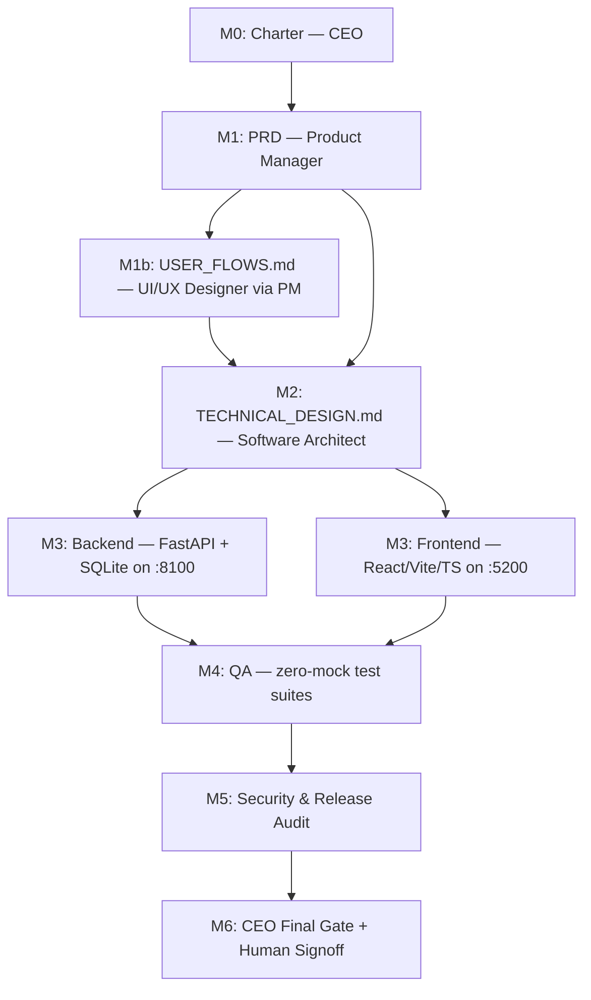

# Link Management System (LMS) & Click Analytics Platform — Master Project Execution Plan

**Project**: `lms-platform` | **Workspace**: `poc/lms/` (all deliverables contained here)
**Charter ratified by**: CEO / Project Orchestrator (Root Orchestrator) | **Date**: 2026-09-26
**Status**: RATIFIED — Phase 1 attempt 1 (subtask-2abdfaf7b4 -> product-manager, 2026-09-26) FAILED: upstream API 500; retry pending (plumbing verified: platform API live on :8000, 7 subordinates registered, all repo_path = lms workspace, ports 8100 & 5200 free)

---

## 1. Executive Vision & Objectives

- **Vision**: Deliver a modern, high-performance Link Management System and Click Analytics Platform (comparable to Dub.co / Bitly) providing instant slug-based redirection and rich click intelligence.
- **Target Audience / Stakeholders**: Marketers and content operators sharing tracked short links; the Human Operator (project sponsor) requiring a production-grade build.
- **Core Value Proposition**: Sub-millisecond slug lookup redirects, real-time click analytics, polished dark-mode dashboard, zero-mock test confidence.
- **Primary Success Metric**: End-to-end journey (create link → share → click → view analytics) reliable, with p50 redirect latency in low single-digit milliseconds on SQLite WAL.

## 2. Tech Stack Baseline & Reserved Infrastructure

| Layer | Technology | Notes |
|---|---|---|
| API Server | FastAPI + uvicorn (Python 3.11) | Aligned with platform baseline (fastapi 0.104.x family, pydantic v2) |
| Database | SQLite (WAL mode) | Covering indexes for slug lookup + click time-series queries |
| Client | React + Vite + TypeScript (strict) | antd components, react-router, dark mode |
| Analytics UI | Charting library per Architect design | Must satisfy platform dataviz standards |
| Testing | pytest (backend), client/E2E suite per Architect | ZERO MOCKS — real SQLite, real API routers |

**Reserved Ports (verified free at charter time)**:
- **8100** — LMS API server (FastAPI/uvicorn)
- **5200** — LMS dashboard client (Vite dev server)
- **8000** — RESERVED for the AI Agents Platform API. The LMS MUST NOT bind this port.

## 3. Milestone Roadmap & Stage Gates

| Milestone | Objective | Owner | Deliverables | Gate Criteria | Status |
|---|---|---|---|---|---|
| **M0: Charter** | Ratify execution plan | `ceo-orchestrator` | `PROJECT_PLAN.md` | Milestones, ports, stack baseline ratified | ✅ COMPLETE |
| **M1: Product Specification** | Requirements & UX flows | `product-manager` (→ `ui-ux-designer`) | `PRD.md`, `USER_FLOWS.md` | User stories w/ acceptance criteria; MVP scope locked; 4-state (Loading/Empty/Active/Error) coverage for every screen | ⚠️ RETRY PENDING (attempt 1 failed: upstream API 500) |
| **M2: Technical Architecture** | Clean architecture & contracts | `software-architect` | `TECHNICAL_DESIGN.md` | Folder structure, SQLite schema w/ indexes, explicit OpenAPI contracts, redirect hot-path design | ⏳ PENDING |
| **M3: Implementation** | Backend + Frontend build | `software-architect` → `backend-developer`, `frontend-developer` | Working API on :8100, dashboard on :5200, migrations | Endpoints live per OpenAPI contract, UI renders all 4 states, 0 build errors | ⏳ PENDING |
| **M4: Quality Assurance** | Zero-mock test suites | `qa-test-engineer` (via architect) | Unit + integration + E2E suites, test report | 100% pass rate, 0 critical bugs, real SQLite/API only | ⏳ PENDING |
| **M5: Security & Release Audit** | Independent release gate | `release-security-reviewer` | `RELEASE_REPORT.md` | Secrets clean, open-redirect/SSRF audited, deps CVE-clean, build reproducible, GO verdict | ⏳ PENDING |
| **M6: Final Gate & Signoff** | Executive review | `ceo-orchestrator` | Executive summary to Human Operator | Human signoff received | ⏳ PENDING |

## 4. Dependency Graph (DAG)



**Critical Path**: M0 → M1 → M2 → M3 → M4 → M5 → M6

## 5. Non-Functional Requirements & Engineering Mandates

1. **Redirect performance**: Slug → destination hot path MUST be a single indexed lookup returning 302/307 with minimal middleware overhead. Target: sub-millisecond DB lookup.
2. **Click capture**: Click events recorded WITHOUT blocking the redirect (fire-and-forget/buffered), capturing timestamp, slug, referrer, user-agent, geo if available.
3. **Slug uniqueness**: DB-level unique constraint with collision-safe generation retry.
4. **Open-redirect / SSRF defense**: Destination URL validation (http/https scheme allowlist; no private/loopback IP targets by default); independent audit in M5.
5. **Zero Mocks Policy**: all tests run against real SQLite and real API routers (platform invariant).
6. **Dark mode, charts, copy-to-clipboard** are first-class MVP dashboard features.
7. **Resumability**: agent runs capture session ids; no subtask may end COMPLETED without on-disk deliverable verification by the CEO.

## 6. Risks, Constraints & Mitigations

| Risk | Likelihood | Impact | Mitigation |
|---|---|---|---|
| Redirect hot path slow (ORM/middleware bloat) | Medium | High | Architect mandates lean query layer on redirect route; QA adds latency assertions |
| Open redirect / SSRF via user-supplied destinations | Medium | High | Scheme + IP validation at creation; M5 independent audit |
| SQLite write contention on click bursts | Medium | Medium | WAL mode, buffered/async click writes, index-only time-series queries |
| Slug collisions at scale | Low | Medium | Unique index + bounded regeneration retries |
| Port drift colliding with platform services | Low | High | 8100/5200 reserved in charter; 8000 forbidden |
| Scope creep beyond MVP | High | Medium | PM enforces strict MVP containment; changes route to CEO |
| Circular delegation / agent stalls | Low | Medium | CEO monitors task tree; bounded atomic prompts; escalation protocol |

## 7. Governance & Human-in-the-Loop Protocol

- **Exclusive HITL**: Only `ceo-orchestrator` interfaces with the Human Operator. Subordinate escalations route up-chain (Tier 1 project memory → Tier 2 direct manager → Tier 3 human).
- **Stage-gate enforcement**: No phase begins before the preceding phase's deliverable is verified ON DISK by the CEO.
- **API contract invariant**: No unilateral contract changes without Architect sign-off.
- **Escalation matrix**: Tech stack, contract disputes, QA failures, and security remediation are resolved autonomously by the CEO; only vision redefinition or destructive/production actions reach the Human Operator.
- **Delegation ledger**: Every dispatch runs via `python3 -m orchestration.delegate --target-agent <id> --prompt "..."` from `poc/`, attached to the active root task with generous timeouts.

## 8. Verification Workflows (per platform CLAUDE.md)

```bash
# Backend suite (zero mocks, real SQLite) — final layout per TECHNICAL_DESIGN.md
pytest <lms backend/tests> -v
# Client build (strict TypeScript)
cd <lms dashboard> && npm run build
```

## 9. Delegation Ledger (CEO dispatch registry)
| Phase | Target Agent | Subtask ID | Dispatched At | Timeout | Status |
|---|---|---|---|---|---|
| M1: PRD.md + USER_FLOWS.md | product-manager (delegates → ui-ux-designer) | `subtask-2abdfaf7b4` | 2026-09-26 14:53 | 3600s | ❌ FAILED (upstream API 500, 41s, no artifacts, no children) — retry pending |
